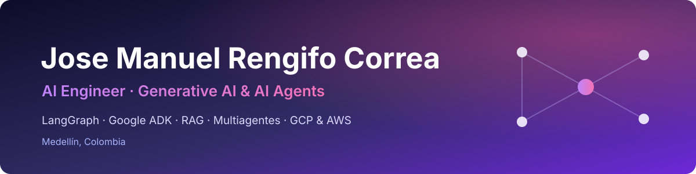

 

## 👋 Sobre mí

Soy **AI Engineer en Sofka Technologies**. Diseño y construyo soluciones de **IA generativa, agentes y sistemas multiagente**, desde la arquitectura y la experimentación hasta su integración y despliegue en producción.

- 🤖 Construyo agentes con **LangGraph** y **Google ADK**: grafos, flujos agénticos, RAG, herramientas y memoria.
- ☁️ Despliego e integro soluciones en **GCP** y **AWS** (Lambda, API Gateway, S3, Glue, Athena) con CI/CD.
- 💬 Tengo experiencia en **bots conversacionales** (chatbots y voicebots) para WhatsApp, Webchat y contact center (Genesys Cloud).
- 📊 Vengo del mundo de los **datos**: SQL, ETL, PySpark y Power BI.
- 🎓 Estudio Ingeniería de Sistemas en el **ITM** (Medellín).

## 🛠️ Stack

**IA y LLMs**

**Backend y datos**

**Cloud y DevOps**

**Canales conversacionales**

## 🚀 Proyectos destacados

| Proyecto | Descripción | Tecnologías |
| --- | --- | --- |
| [**agentes-ia-langgraph**](https://github.com/joem9819/agentes-ia-langgraph) | Colección de agentes con LangGraph: agente de soporte con enrutamiento por intención, RAG y agendamiento de citas, agente ReAct, revisión de código en paralelo, orquestador-trabajadores y evaluador-optimizador. Expuesto con FastAPI y *streaming*. | LangGraph · OpenAI · FastAPI |
| [**adk-google**](https://github.com/joem9819/adk-google) | Agentes con Google ADK y Gemini, con *guardrails* mediante *callbacks* antes del modelo y antes de las herramientas. | Google ADK · Gemini |
| [**sistema-administracion-control-inventarios**](https://github.com/joem9819/sistema-administracion-control-inventarios) | Aplicación web para administrar el inventario de un supermercado con varias sucursales. Proyecto académico en equipo. | Flask · MySQL |

## 💼 Experiencia

- **AI Engineer** · Sofka Technologies · *2026 – actualidad*
- **Desarrollador de soluciones IA** · Emtelco · *2024 – 2026*
- **Analista de automatización** · Emtelco · *2022 – 2026*
- **Analista de datos** · American Scan Services and Solutions · *2021 – 2022*

## 📜 Certificaciones recientes

- **Anthropic**: Building with the Claude API · Claude Code in Action · AI Fluency: Framework & Foundations
- **Platzi**: Agentes con Gemini Enterprise AI Platform · Arquitectura de Software Aplicada · Fundamentos de LLMs · Prompt Engineering · Google Cloud Platform

---

📫 ¿Hablamos? Escríbeme por [LinkedIn](https://www.linkedin.com/in/jose-manuel-rengifo/) o a [joem9819@gmail.com](mailto:joem9819@gmail.com).

